# comfyui-obvpm

ComfyUI nodes to save time and keep your workflows tidy. Bundle multiple wires into one wire. Create customizable presets nodes. Auto compose multiple images into reference sheets.

## Updates

**Also check out my new Timeline node:**  https://github.com/chanon/comfyui-obvpm-timeline It not only lets you extend videos seamlessly, but also **prepend, bridge and even create seamless loops with motion context**!

### 0.2.18 (2026-10-21)

- Added: a Value Presets node can lend one of its presets to another pack's tool without changing the node (the Timeline runs takes with one).

### 0.2.17 (2026-10-18)

- Unbundle: changing one field of a bundle re-runs only what uses that field. This is done by converting the Unbundle to a virtual node, it is left out of the prompt and each output is wired straight to that field's source, the way KJNodes' Set/Get work. It stays a real node wherever that cannot be done safely. Contributed by bananasss00 (#23).
- Fixed: an Unbundle's `get` list now offers a KJNodes Set fed from another Unbundle's output when it carries a bundle (it was left out, so the list could be empty).
- Fixed: an Unbundle of a bundle taken out of another bundle now names its fields when that inner bundle came from a Value Presets node or a switch, not only from a Bundle.
- Fixed: clicking the arrows of a dropdown with nothing to choose (an Unbundle's `get`, a switch's `selected`, a Value Presets dropdown) could freeze the page; the value now stays as it was.

### 0.2.16 (2026-10-15)

- Value Presets and Override Bundle Values: a model in a hidden field (turbo off, an override off) no longer brings up ComfyUI's "Missing Models" warning; shown later and missing, it does, and the warning goes when the field is hidden again.
- Fixed (timeline #47): a Bundle or Value Presets node set to a constant lost its name when its workflow had been opened with an older comfyui-obvpm, so its Gets read nothing; it now puts the name back when the workflow opens. When nothing comes in on `bundle`, the error says to check the Get's name.
- Switching to a workflow's tab is faster with auto Bundles (the spare input is no longer taken out and put back on every re-check).
- Workflows with Bundle, Unbundle or the auto switches open faster still: about 0.25 s less for a 200-node workflow (sizes and sockets are worked out once, not once per socket; the theme's colours are kept).
- Workflows with Bundle, Unbundle or the auto switches **open much faster** (a 200-node workflow: about 7 s to 3 s, or 13 s to 5 s with Nodes 2.0) -- they re-checked the whole graph once per wire while loading; now once.

## YouTube Intro Videos

To quickly see what these nodes are useful for, you can check out these YouTube videos that I made to introduce them

- [Load Images & Compose](https://www.youtube.com/watch?v=xjSflq85DqI) - Lets you compose ref images in a single node
- [Bundle Wires](https://www.youtube.com/watch?v=_j9aaXAmIzQ) - Lets you bundle multiple wires into a single wire
- [Value Presets Node](https://www.youtube.com/watch?v=gRt_NdzFjTw) - Lets you creat customizable presets for any workflow
- [Creating a Clean R2V Workflow with Customizable Presets](https://www.youtube.com/watch?v=4-TVn0TscmM) (the resulting workflow is [here](workflows/h3_obvpm_r2v.json))

## Support this work

If these nodes save you time, consider supporting their development on Patreon.

<a href="https://www.patreon.com/cw/obvpm"></a>

## Follow me for Updates

I'm working on more nodes and workflows, so follow me on X at https://x.com/chanons

## Installation

Clone (or copy) this folder into `ComfyUI/custom_nodes`:

```
cd ComfyUI/custom_nodes
git clone https://github.com/chanon/comfyui-obvpm
```

Restart ComfyUI. No extra Python dependencies are required.

Every node in this pack is listed with **(obvpm)** after its name, so searching the node menu for `obvpm` finds all of them. The names used throughout this document leave that suffix off.

## Nodes in this pack

**[Image nodes](#image-nodes-obvpmimage)** — obvpm/image

| Node                                                            | What it does                                                                 |
| --------------------------------------------------------------- | ---------------------------------------------------------------------------- |
| [Load Image & Crop](#load-image--crop)                          | Load Image with an interactive crop editor on the node                       |
| [Load Images & Compose](#load-images--compose)                  | Load multiple images, crop them, and then pack them into one reference image |
| [Downscale Image to Megapixels](#downscale-image-to-megapixels) | Scale an image down to a pixel budget, never up                              |

**[Value Presets](#value-presets)** — obvpm/bundle

| Node                                              | What it does                                                |
| ------------------------------------------------- | ----------------------------------------------------------- |
| [Value Presets](#value-presets)                   | Named presets from an editable template, output as a bundle |
| [Override Bundle Values](#override-bundle-values) | Override some of a bundle's values -- a preset's -- per run |

**[Bundles](#bundles-obvpmbundle)** — obvpm/bundle

| Node                              | What it does                               |
| --------------------------------- | ------------------------------------------ |
| [Bundle](#bundle)                 | Pack several values onto one wire          |
| [Unbundle](#unbundle)             | Expand a bundle back into wires            |
| [Peek Bundle](#peek-bundle)       | Show what is on a bundle wire              |
| [Bundle to List](#bundle-to-list) | Turn a bundle's values into a ComfyUI list |

**[Compatibility Check](#compatibility-check)** — obvpm/gates

| Node                                        | What it does                                               |
| ------------------------------------------- | ---------------------------------------------------------- |
| [Compatibility Check](#compatibility-check) | Refuse to run until the install meets the workflow's needs |

**[Gates and Switches](#gates-and-switches)** — obvpm/gates, obvpm/switches

| Node                                                                                                                            | What it does                                                |
| ------------------------------------------------------------------------------------------------------------------------------- | ----------------------------------------------------------- |
| [Optional Image / Video / Audio / Latent / Any](#optional-image--optional-video--optional-audio--optional-latent--optional-any) | Pass a value through; mute or bypass when it is missing     |
| [Required Model](#required-model)                                                                                               | Refuse to queue until a model is wired in                   |
| [Mute If](#mute-if)                                                                                                             | Block everything downstream on a boolean                    |
| [Mute Group If](#mute-group-if)                                                                                                 | Mute the group it sits in on a boolean known before the run |
| [Lazy Switch](#lazy-switch)                                                                                                     | Boolean two-way switch; only the chosen side runs           |
| [Lazy Switch 2 Values / 3 Values](#lazy-switch-2-values--3-values)                                                              | The same switch for two or three values together            |
| [Lazy Case Switch](#lazy-case-switch)                                                                                           | Pick a branch by name from a list you write                 |
| [Lazy Case Switch (auto)](#lazy-case-switch-auto)                                                                               | Pick a branch by the title of the node feeding it           |

**[Misc](#misc)** — obvpm/values, obvpm/misc

| Node                                                                             | What it does                                              |
| -------------------------------------------------------------------------------- | --------------------------------------------------------- |
| [Dropdown](#dropdown)                                                            | A dropdown with choices you define                        |
| [First Float / First Int (else fallback)](#first-float--first-int-else-fallback) | First connected value, or a fallback                      |
| [Lora Name](#lora-name)                                                          | A LoRA file name on a wire                                |
| [Sampler Name](#sampler-name)                                                    | A sampler choice on a wire                                |
| [Scheduler Name](#scheduler-name)                                                | A scheduler choice on a wire                              |
| [Clean VRAM](#clean-vram-obvpmmisc)                                              | Unload models and free cached VRAM mid-graph              |
| [beta57 scheduler](#beta57-scheduler)                                            | Not a node: a scheduler added to every scheduler dropdown |

## Image nodes (obvpm/image)

### Load Image & Crop

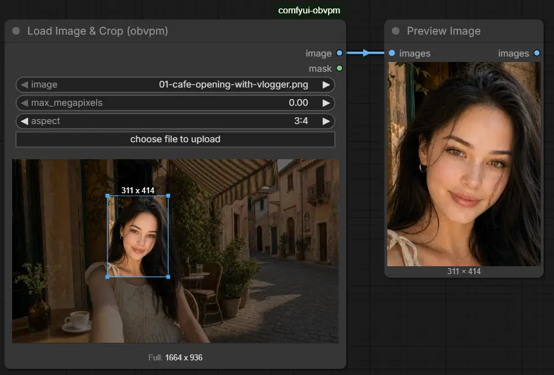

A Load Image with an interactive crop editor drawn directly on the node:

- **Drag** on the image to draw a crop area.
- **Drag inside** the selection to move it; **drag a corner** to resize.
- **Click** (without dragging) outside the selection to clear it.
- With no crop drawn, the full image is output.
- **Fixed aspect**: set `aspect` (16:9, 1:1, 4:5, …) and the crop rectangle keeps that shape while you draw, move or resize it — switching ratios snaps an existing crop in place (same center, same area). With no crop drawn, a dashed rectangle shows the largest centered cut of that ratio, which is what the node outputs. `free` is the unconstrained editor. A stored crop that disagrees with the ratio (hand-edited, or the aspect changed by wire) refuses at run time rather than being silently reshaped.

The label above the selection shows its size in source pixels; the row under the preview shows the full image size. If `max_megapixels` is greater than 0, the output (crop or full image) is scaled down to fit within it, aspect preserved — the preview labels show the resulting size as `Downscaled To:`. A value of `0` disables the cap.

| Input            | What it does                                                                         |
| ---------------- | ------------------------------------------------------------------------------------ |
| `image`          | The file to load. Upload, drag & drop, paste, or pick an existing input file.        |
| `crop`           | Managed by the crop editor; stored in normalized coordinates so it survives reloads. |
| `max_megapixels` | Downscale the output to fit this many megapixels. `0` disables.                      |
| `aspect`         | `free`, or a fixed ratio the crop keeps.                                             |

Outputs are `image` and `mask` (from the alpha channel, like the stock Load Image). Changing the crop re-executes the node on the next run. Works in both the classic canvas renderer and Nodes 2.0.

**Painting a mask**: right-click the node → **Open in MaskEditor** opens ComfyUI's own mask editor on the loaded file, exactly as on the stock Load Image. Saving writes a painted copy under the input folder's `clipspace` directory and points the node at it; the crop stays where it was (the copy has the source's size), and both `image` and `mask` come out cropped together.

### Load Images & Compose

Several input images, each with its own crop, composed into **one** image within a megapixel budget.

A node with no images outputs `None`, the same as an unconnected optional input, so a spare one can stay wired into a reference slot without being bypassed.

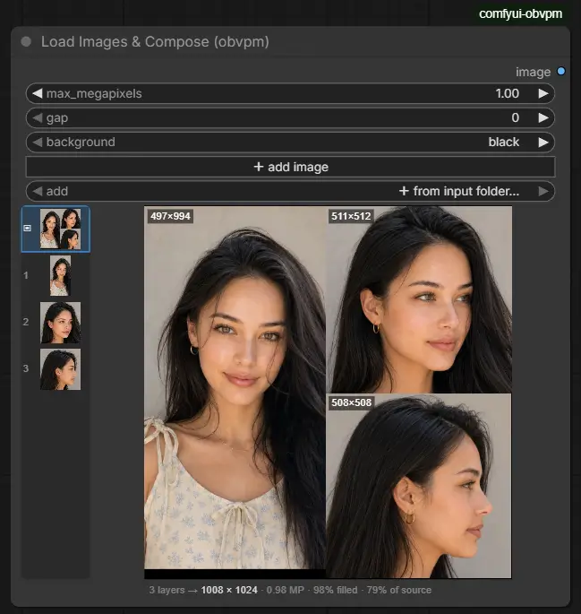

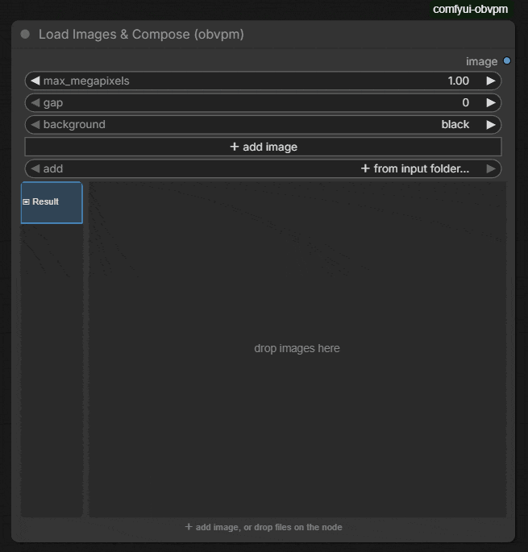

#### Editing

The node body is a layer strip on the left, a main view on the right, and one info line under both. Drag the divider between the strip and the view to widen the strip; its thumbnails grow with it, and the width is saved with the workflow. Entries keep their size however many layers there are, and the strip scrolls past what fits.

- **Add** an image with the `＋ add image` button (opens a file dialog and uploads), by picking one with `＋ from input folder…` (a dialog listing the input folder, subfolders included, with a search box; the folder is read only when you open it), by **dropping image files onto the node**, or by **pasting an image from the clipboard** while the node is selected — each becomes a new layer. Cards dragged from the **Artius browser** work too; one already in the input folder is referenced in place rather than copied.

- **Select** a layer by clicking it in the strip. **Delete** it with the ✕ badge on the layer, or press Delete or Backspace while the pointer is over the node. Up and Down move the selection along the strip. **Reorder** by dragging a layer up or down the strip; the insertion point is drawn as you go.

- **Mute** a layer with the eye badge at the top left of its entry (or the **mute** pill under its image): it stays in the list, faded with the eye struck through, but is left out of the composed image and of the separate images in `extras` until unmuted.

- **Crop** the selected layer in the main view, exactly like [Load Image & Crop](#load-image--crop): drag to draw, drag inside to move, drag a corner to resize, click outside to clear. Each layer keeps its own crop, and the layout re-plans as you drag.

- **Per-layer aspect lock**: the `aspect: …` pill in the crop view opens a menu of fixed ratios (16:9, 1:1, 4:5, …). With a ratio set that layer's crop keeps the shape while drawing and resizing, switching ratios snaps the crop in place, and with no crop drawn a dashed rectangle shows the largest centered cut of that ratio — which is what composes. Each layer locks independently; `free` is the default.

- Under the image, next to the aspect pill: **duplicate** adds the same image again as a new layer (crop and aspect copied, inserted right after, selected); on the far right, **mute** / **unmute** and **delete** — the same actions as the badges in the list.

- The first entry in the strip is **Result**: the real composition, at the real aspect ratio, each slot labelled with its pixel size. Its thumbnail in the strip is the composition too, so the sheet is visible without selecting it. Clicking a slot there jumps to that layer's crop editor. The **gap** pill under it sets the space between the layers.

The info line reads `4 layers → 1104 × 928 · 0.98 MP · 92% filled · 57% of source` — how much of the sheet is image, then the single scale factor being applied — and adds the selected layer's slot size.

#### How the layout is chosen

**Layers keep their order, their exact aspect ratio, and their relative pixel sizes.** Every one is scaled by the *same* factor and none is ever **enlarged**, so a 300×200 crop beside a 3000×2000 one comes out nine times smaller in area, because that is what it is. A small crop cannot take space from a large one by being stretched to fill a slot.

That makes `max_megapixels` a **cap, not a target**: four 256×256 images compose to a 512×512 sheet however large the budget, because enlarging them would be inventing pixels. Set it to `0` for no cap at all: every layer stays at its own size.

**Nothing is ever rotated.** A rotated reference is a wrong reference, so the quarter-turn a texture-atlas packer would take for free is not attempted at any point.

The packer sweeps 48 candidate sheet widths and four placement orders — your layer order, then tallest, widest and largest first. **Your order is the default answer** and is only displaced by an ordering that packs at least three points tighter, so dragging layers around still means something. The info line names the order actually used and how full the sheet came out.

- **Presets**: the `preset` dropdown loads a saved set of images and settings (the layers with their crops, aspects and mutes, and `max_megapixels`, `background`, `padding` and gap); **save as** keeps the current one under a name, **save** overwrites the chosen preset, **delete** removes it. Once anything differs from the chosen preset the dropdown reads `preset ✎ modified` (its tooltip says what: the layers, or which settings, which are also starred) and **save** and **revert** appear (revert puts the preset's images and settings back); both are hidden while nothing has changed. Each preset is its own file in your user folder (`user/default/obvpm/compose_presets/<name>.json`), so every Load Images & Compose node in every workflow can use them, and a preset can be shared by passing its file on. A preset names files in the input folder; it does not copy the images.

#### Settings

| Setting          | What it does                                                                                                                                                                                                                      |
| ---------------- | --------------------------------------------------------------------------------------------------------------------------------------------------------------------------------------------------------------------------------- |
| `max_megapixels` | Largest the result may be (1.0 = 1024×1024 pixels) — a cap, not a target, so a sheet of small images comes out small. `0` = no cap (in `fill` sizing, a sheet of the sources' total area). Sides are rounded to a multiple of 16. |
| `background`     | `black`, `grey` or `white` — seen in the gaps, the padding and the up-to-16-pixel margin left by rounding.                                                                                                                        |
| `padding`        | Pixels of background all round the composed image and all round each separate image in `extras`. Added outside `max_megapixels` (the cap is the layers' budget); the composed image's sides stay a multiple of 16.                |
| gap              | Pixels of background between layers, set with the **gap** pill under the Result view. `0` puts them flush; a few pixels helps a model tell one reference from the next.                                                           |

#### Outputs

- `image`: the composed image, every layer that is not muted.
- `extras`: a bundle — take it apart with Unbundle:
  - `selected_image`: what is selected in the strip — that layer alone, cropped and padded (even when it is muted), or the composed image when **Result** is selected;
  - `images_bundle`: the layers that are not muted as a bundle of their own, `image_0`, `image_1`, … in list order, each cropped and padded at its own size (an Unbundle on it names them; [Bundle to List](#bundle-to-list) turns them into a list).

Changing any crop, mute, the selection, or the file behind any layer re-executes the node on the next run.

### Downscale Image to Megapixels

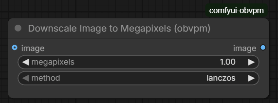

Scales an image down so its total pixel count fits within `megapixels`, keeping aspect ratio. Images already at or under the target (and on the `resolution_steps` grid) pass through completely untouched (no resample). With no image connected it outputs `None` (bypass). 1.0 megapixels = 1024×1024 pixels, matching ComfyUI's `ImageScaleToTotalPixels` convention.

| Input              | What it does                                                                                                                                                                             |
| ------------------ | ---------------------------------------------------------------------------------------------------------------------------------------------------------------------------------------- |
| `megapixels`       | Maximum output size. Larger images are scaled down to fit; smaller ones pass through.                                                                                                    |
| `method`           | Resampling filter: `lanczos` (default), `area`, `bicubic`, `bilinear`, `nearest-exact`.                                                                                                  |
| `resolution_steps` | Round the output width and height **down** to a multiple of this (default 32). `1` = no rounding. An image within the budget but off the grid is snapped too; nothing is ever scaled up. |
| `image`            | Optional. Unconnected outputs `None`.                                                                                                                                                    |

## Value Presets

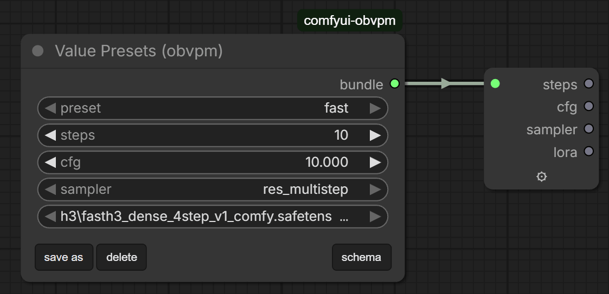

Named sets of values on one wire, from a template you edit in the graph. Its output is an ordinary [bundle](#bundles-obvpmbundle), unpacked with Unbundle.

This node keeps one copy of the structure and as many copies of the values as you like:

| Widget             | What it holds                                                               |
| ------------------ | --------------------------------------------------------------------------- |
| `schema` (hidden)  | the template: one field per line, with its type — edited through the dialog |
| `preset`           | which saved set is loaded — `custom` is whatever you set by hand            |
| `values` (hidden)  | what is set right now, keyed by name                                        |
| `presets` (hidden) | the saved sets, also keyed by name                                          |

Output: `bundle` — an ordinary bundle, so Unbundle works on it unchanged (hide fields in its config to take a subset), and Unbundle traces this node's field names exactly as it traces a Bundle's.

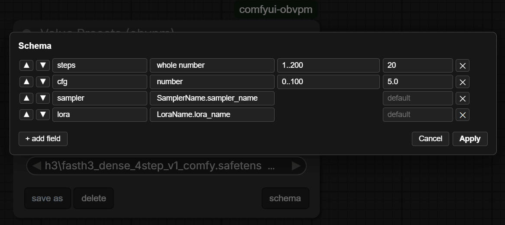

**Editing the template is cheap**, which is the point. Everything is keyed by name and nothing by position:

- **add** a field → every stored preset gains it at its default;
- **remove** one → the leftover value is ignored, not shifted onto the field after it;
- **reorder** them → nothing moves at all;
- **rename** one in the schema editor → its stored value is carried to the new name, in the node's own values *and in every preset*.

**Editing the fields.** Press **config** (its **Schema** page) for a row per field — name, type, range or choices, default, condition, tooltip (with a ✎ button that opens it in a larger box) — with a grip to drag and ▲▼ to reorder (Alt+↑/↓ moves the row you are typing in; Shift-drag or Alt+Shift+↑/↓ moves a whole group, and a field dropped inside another group joins it), **+ add field** adding under the row you last worked in, and a searchable type picker. The picker offers the basic types and then **every dropdown on this install**. **edit as text** opens the schema as plain text, for pasting one in, copying this one out, or writing several lines at once; *Use this schema* checks it and replaces the rows (the node is only changed when you press Apply).

**The schema text.** One field per line: `name: type [range or choices] [= default] [when field = value] [# tooltip]`

```
turbo_loader: choice off, normal, larryvrh = off   # which loader applies the turbo LoRA
turbo_lora: @LoraName (obvpm).lora_name when turbo_loader != off
turbo_strength: float 0..1.00 = 1.0 when turbo_loader != off
steps: int 1..200 = 20
```

- **Types** are `text`, `int`, `float`, `bool`, `choice a, b, c`, and `@Node.input` to borrow another node's dropdown, which then tracks that list instead of a copy of it. A float range sets the decimals shown (`0..1.0` one, `0..1.00` two).
- **`when field = value`** (or `!=`, and `a, b` for any of several) shows the field only while a `choice` or `bool` field **declared above it** holds one of those values. While hidden, the field's value **on the bundle is `None`** — whatever is stored — so nothing downstream acts on a setting the node is not showing. The stored value is kept and returns with the field. A field whose deciding field is itself hidden is hidden too.
- **`# tooltip`** at the end of the line is shown when hovering over the field. (A `#` at the *start* of a line is a comment.)
- **`## Title`** on a line of its own puts a heading over the fields below it, until the next heading (a bare `##` ends a group). Display only: the bundle and the stored values do not change.

**Fields switched off on one node.** Nodes can share a schema and presets (one Preset Type Id) without all using every field: on the config **Schema** page, untick a field's **on** box and it is hidden on *this* node and `None` on its bundle; the schema itself stays the same. Fields that depend on it (`when`) still see it at its default.

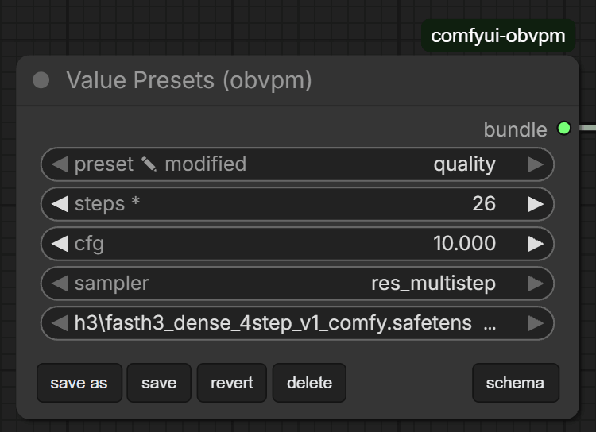

**What runs is what you see.** Selecting a preset writes its values into the controls, and they stay **editable**. Change one and the node does not quietly detach the label: it keeps saying which preset the values came from and marks itself modified.

**The row under the fields.** **save as preset** stores the current values under a new name. With a preset selected: **save** writes your edits into it and **revert** puts its values back (both only while something is modified), **rename** gives it another name with its values kept, and **delete** removes it (the values stay on the node). **config** opens the settings: the presets (Presets), the fields (Schema), your dropdown filters (Filters) and set to constant (Set).

**User presets.** On the config **Presets** page, give the node a **Preset Type Id** (for example `obvpm-h3-generation-engine`) and **save as** asks whether to save a *workflow preset* or a *user preset*. User presets are kept outside the workflow, in your ComfyUI user folder, one file per preset (`user/default/obvpm/presets/<preset-type-id>/<name>.json` for the default user; the file name is a safe spelling of the preset's name, the name itself is inside), and every Value Presets node with the same Preset Type Id — in any workflow, any version of it — lists them, marked ★. So a preset you saved in one version of a workflow is still there in the next. The workflow presets are what it ships with; untick any of them on the same page and the chooser stops offering it (it stays in the workflow). The Preset Type Id is set by the workflow's author, once, so every version of the workflow carries it; each user's presets stay their own. Pick a distinctive id: nodes with the same id share user presets, even across unrelated workflows.

**Shared workflow presets.** Nodes in a workflow with the same Preset Type Id also share their *workflow* presets: saving, renaming, deleting or importing one on any of them changes the list on all of them (each node still has its own selection and its own hidden presets). When a node joins — its id is set to one other nodes already use, or it is pasted in — the lists are merged: a preset the group already has under the same name with different values keeps the name, and the joining node's becomes "name 2" (its selection follows, so nothing it runs changes). If the lists ever differ (edited by an older version), the Presets page says so and offers **Sync from this node**; loading a workflow never changes them.

**Export / import.** Also on the Presets page: **Export…** copies or downloads one preset — a user or a workflow preset, the node's own to start with — as a small JSON file, the same file it is in the user presets folder, so it can also be dropped in there (to move all your user presets, copy that folder); **Import…** takes preset files in — pasted, or several opened at once — lists the presets they hold (marking those whose name is already there; an older export can hold many) and takes the ones ticked, into the workflow presets or the user presets, keeping both or replacing on a name clash. Presets are matched to fields by name, so they import into a node whose schema differs: a field it lacks is ignored, one the preset lacks takes its default.

**Choosing the preset with a wire.** Wire a text into the `preset` input and it *selects* that preset: its saved values run (a field it was saved without takes its default), whatever is set on the node by hand — for testing several presets in a row, or picking one from elsewhere in the graph. The name can be a workflow preset or a user preset (a plain name means the workflow's first; `★ name`, as the chooser shows it, always the user preset); `custom` runs the node's own values. When the name is known before the run — a text or primitive node, or an obvpm switch whose choice is known — the node applies the preset at once, so its fields always show what will run, and follows the wire as it changes. A name only made during the run (a list, a loop, a file reader) is looked up then, and the node shows the preset that ran afterwards. While the input is wired, the chooser reads `preset ⇠ input`. An unknown name stops the run, naming the presets there are. The user presets of the node's Preset Type Id are put in the prompt while the input is wired, so the server never reads your user folder; as every prompt is embedded in the files a run saves, those outputs carry them too. To batch through presets, feed `preset` from any node that gives a different name per run — say, one that picks a line of a list of preset names by an index set to *increment* — and queue as many runs as there are names.

**Dropdown filters.** A long dropdown (every model file on the machine, say) can be cut down to the entries you use, per field, on the config **Filters** page: it lists the node's dropdown fields, each with an **include** and an **exclude** box, one pattern per line. A field lists the entries that match *any* include line (all of them when there is none) and *no* exclude line, so the order never matters and an exclude always wins. A pattern matches anywhere in the entry and ignores case, `*` stands for anything, and `\` and `/` are the same (`h3/` matches a folder). The page shows how many entries each field keeps (and **list** shows them) as you type. The filters are yours: they are saved with your user presets, in the Preset Type Id's settings file beside their folder (`user/default/obvpm/presets/<preset-type-id>.json`), so they need a Preset Type Id and every node with that id uses them, in every workflow — Override Bundle Values too, for the fields of a bundle from those nodes. Only the dropdown changes: presets and runs still take any entry, the value a field holds is always listed, and a filter that would leave nothing is not applied (the tooltip says how much of the list a filtered field shows).

**Set to constant.** On the config **Set** page, turn on *set this bundle to a constant*: the node gets a **set_constant** field, its last one above the buttons (named after the node's title to start with), and an Unbundle with *get* or a KJNodes Get reads this node's bundle by that name, without a wire, the same as a Bundle's *set*. Set or change the name in that field; getters follow a rename. The node keeps its title.

**A borrowed dropdown's default.** A default names something on the schema author's machine — a model or LoRA file — that another install may not have, or has in another folder. The field then keeps its dropdown and starts on the list's first entry (its tooltip says so), instead of turning into a text field.

### Override Bundle Values

Overrides some of a bundle's values without touching where they came from — typically a Value Presets node, so a preset can hold a setting (a model, the steps) that a user can still change for one run.

- **Choose the fields** in the node's config dialog (the gear). Each chosen field gets a **toggle**: off, the bundle's own value passes (the toggle shows it); on, the value row under it replaces it.
- **From a Value Presets node** the value row is that node's own control for the field — same range, decimals, choices (borrowed dropdowns included) and tooltip — and an override is checked the same way when it runs. The schema's `when` lines apply again: turning a deciding field on brings back the fields it hides, with the values the preset holds for them.
- **From any other bundle**, a field's type comes from what is wired into the Bundle; an override keeps the type of the value it replaces.
- **Through a switch** (Lazy Switch, Lazy Case Switch, a reroute): when the switch's choice is already settled in the graph — its own boolean or `selected`, or a value traced to a widget, a primitive, a Value Presets field or an Unbundle field — only the branch it will pick counts, and the toggles show that branch's values, following the choice as it changes (the timeline pack's upscale toggle drives its engine settings selector this way). A node can declare an output as known before a run with `node.obvpmStaticOutput(slot)`. When the choice is only known at run time, the dialog offers the fields every branch carries and a toggle shows the bundle's value only when the branches agree on it. Traced through subgraphs, Set/Get pairs and "set to constant" presets alike.
- **Values no widget can hold** (an image, a model, a latent) get an **input socket** instead: wire something in and it replaces the field; leave it unwired and the bundle's own value passes.
- **The incoming bundle is never changed** — the same bundle often feeds several nodes — a new one goes out.
- **Set to constant**, as on a Value Presets node: tick *set this bundle to a constant* in the config dialog and the overridden bundle can be read by name — an Unbundle with *get*, or a KJNodes Get — without a wire. The name is the node's `set_constant` field, its last one (above the ⚙).
- **The preset node says so.** A field overridden downstream is labelled *overridden* on the Value Presets node, and disabled when every path from it to a node that reads the bundle overrides that field; *overridden in n of m* when only some do.

## Bundles (obvpm/bundle)

Packs several values onto **one wire** (type `OBVPM_BUNDLE`) so they can travel together.

A bundle is a plain name/value mapping, so anything can go in it, including images, latents and models. 

There is one node per end. Both work the names out from the wires — there is nothing to keep in step — and both carry a **config dialog** (the ⚙ on the node, right-click → Configure…, or double-click) for renaming and reordering on the packing side, reordering and hiding on the unpacking side. In both dialogs, **reordering moves the wires with their fields** — a wire that carried `mask` still carries `mask` wherever its pin lands.

Both nodes also **collapse**: the − button left of the ⚙ folds the node to a single short bar, its wires gathered at each end, like any collapsed node. Expand with the usual control (the dot at the bar's left on the canvas, the chevron in Nodes 2.0) or by double-clicking the bar; right-click → Collapse and Alt+C work as well. The state saves with the workflow.

### Bundle

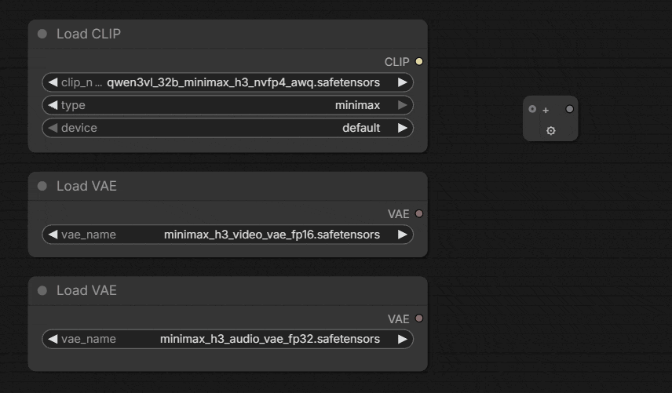

Starts with one empty input and names each field after whatever you plug into it, growing a fresh empty input as each one fills, so there is always exactly one spare. Unplug something in the middle and the gap closes. Up to 128 fields.

The name comes from the far end of the wire — what the producing node calls that output. To choose the names yourself, open the config dialog: a rename sticks to the wire it was made on (it is keyed by the derived name, so it survives re-syncs and falls back to the wire's own name if the wire changes).

The single output is `out`, the packed bundle.

### Unbundle

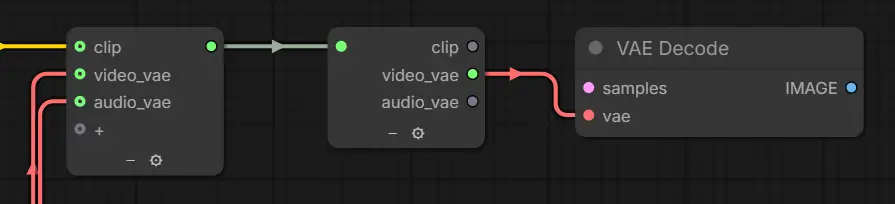

Connect a bundle to `in` and the outputs appear, one per field, labelled with its name.

Wiring something that isn't a bundle into `in` is refused.

Bundles nest: a Bundle's output can itself be a field of another Bundle. Unbundling the outer one puts the inner bundle on the output named after that field, and an Unbundle wired there shows the inner Bundle's fields — the trace follows the wire back through the outer Unbundle to whichever Bundle packed it, at any depth.

The config dialog marks each field with whether the bundle on the wire (or the constant) actually has it: green if it does, red if it does not (that output gives `None`), grey when the source can't be traced, with the reason. It lists every field the bundle has (scrolling when there are many) and says how many are shown; it reorders the outputs (drag a row by its grip, or ▲▼, or Alt+↑/↓) and hides the ones a branch does not need (an Unbundle has up to 128 outputs); hiding is also how you take a single field, or choose which of a larger bundle to expose. A field with connections cannot be hidden — unplug it first. Once a layout is set it also *pins* the outputs: fields added upstream append at the end instead of shifting the existing pins, and a field that disappears upstream while wired keeps its pin (it outputs `None`, with a log line saying so) rather than silently re-meaning everything below it.

### Set / get by name

Bundle and Unbundle can be joined by a **constant name** instead of a wire, the way KJNodes Set/Get nodes hide a connection. Turn it on in the node's ⚙ settings: **Set as a constant** on a Bundle, **Get from a constant** on an Unbundle. It is applied with OK, like the rest of the dialog.

- **Bundle, set on:** a `set` field appears for the name, and the node still packs and outputs its bundle as usual. The title follows the name: `Set name`. Names are unique: taking one that is already used gets a `_0`, `_1`… suffix, as on KJNodes. Renaming it renames every getter that used the old name.
- **Unbundle, get on:** its `in` socket goes away and a `get` dropdown appears. Pick a name, and the outputs become that bundle's fields, exactly as when wired, config dialog included. The title follows the name: `Get name`. Right-click → Go to setter.
- **Turning the option off** puts the node back as it was: the field hides, an Unbundle's `in` socket returns, and the old title comes back.

Collapsed, a node with set or get on shows its title, like a collapsed KJNodes Set/Get.

A node from another pack can be a setter too, always on, with a name field of its own, and an Unbundle that gets that name takes out its fields.

**Compatible with KJNodes Set/Get.** The names are shared in both directions:

- A KJNodes **Get** lists the names Bundles set, and outputs that bundle.
- An Unbundle's **get** lists KJNodes **Set** nodes that carry a bundle, and unbundles what feeds them.

Scope follows KJNodes: a name set in a graph is visible there and in every subgraph inside it. If nothing is set under the chosen name, or the setter is muted or bypassed, the run stops with an error naming the constant.

### Collapsing Bundle/Unbundle

The Bundle and Unbundle nodes have a "-"" icon that can be used to collapse them to save space and reduce clutter for even cleaner workflows.


### Peek Bundle

Shows what is actually on a bundle wire: one line per field, with its name and a short description of the value — shape for images, latents and masks, duration and sample rate for audio, the value itself for numbers, booleans and text. Nested bundles list their field names.

Deliberately a summary rather than a dump: printing a batch of images gives pages of numbers that say nothing about whether the right thing is on the wire, while its shape answers exactly that.

The report is printed on the node itself and is also available as a `text` output. Nothing is unpacked or converted, so it costs nothing to leave wired in, and the last run's report is kept when the workflow is reopened.

### Bundle to List

Turns a bundle into a **ComfyUI list**: every field's value, in the bundle's order, one list item each. The node wired to `list` runs once per item — a Save Image saves each, an upscaler upscales each — and so does everything after it. Keep the list away from a generation unless you mean one run per item.

Made for Load Images & Compose: Unbundle its `extras`, wire `images_bundle` here, and you get its layers as a list, each at its own size (an image batch can't hold pictures of different sizes).

Why a separate node: in ComfyUI a list is something an output socket declares, not something a value is. Unbundle's outputs are the same for every Unbundle, so none of them can be a list; this node's single output is, and shows the list marker.

An empty bundle (every Load Images & Compose layer muted) stops the run with a message saying so, rather than the next node failing with an unclear error.

### Tracing

The names Unbundle offers are traced back through the wire — including through a Lazy Case Switch, through subgraph boundaries, and through KJNodes Set/Get pairs (the Get is followed to its Set, in the same graph or upward through the subgraph the Get sits in).

Tracing back through a **Lazy Case Switch** works when every connected branch packs the same field names — which is precisely when the answer is the same whichever branch ends up running. Branches that pack *different* fields have no single answer, so no names are offered and you give the consumer an explicit list; that list is matched by name, so it stays correct whichever branch wins.

Only sockets that could be carrying the bundle are followed, so a `cases` or `selected` wired in from a Dropdown doesn't make the switch look ambiguous.

Laziness is preserved end to end. A Bundle sits *on* a branch, so when that branch isn't selected the whole thing — bundle and everything feeding it — is skipped, exactly as if the values were wired directly.

## Compatibility Check

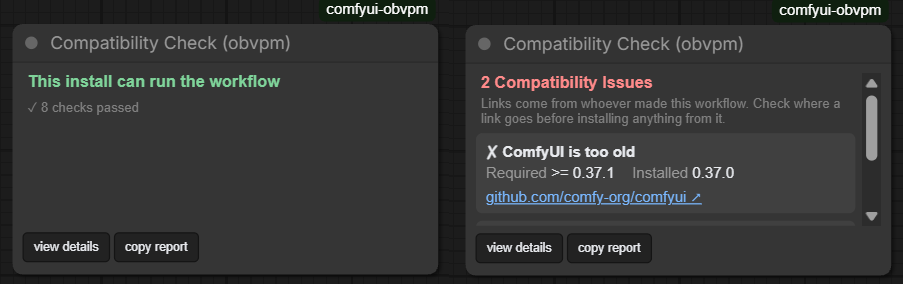

Allows workflow creators to configure the minimum ComfyUI version required, and also what custom node packs are required for the workflow to work. Then when a user opens the workflow, they can see from the node if they are missing any node packs or if they are on a too old version of anything. Also has a "copy report" button that lists the complete installation details for bug reports.

### Details

The node's face says whether this install can run the workflow and names anything that fails; **view details** shows every rule in a table per kind (ComfyUI, node packs, nodes, must not be installed) with the result, what is required, what is installed, the link, and for a failure what was found and the fix. A queued run stops at this node, before anything else runs, with the same list while anything fails. The node has no sockets: just drop it into the workflow.

To change the requirements (this is for the workflow's author), press the **settings** (⚙) button in the details: the tables become editable, with **+ Add** and a remove button per row, a rule's note is edited from its **Note** button, and nothing changes until **Apply** (**Cancel** or Escape backs out). **Edit as Text** opens the same rules as text, one requirement per line, for pasting a list. Under the tables the rules are stored as text, like this:

```
comfyui >= 0.35.0
frontend >= 1.53.0
comfyui-obvpm >= 0.2.3   https://github.com/chanon/comfyui-obvpm
node MinimaxH3LatentUpscaler3D has enable_temporal_chunking   https://github.com/LBH-123-AI/Comfyui_Minimax_h3_latent_Upscaler   # the original pack, not the Plus fork
node ModelPreviewOverrideKJ   https://github.com/kijai/ComfyUI-KJNodes   # ComfyUI-KJNodes
not pack ComfyUI-Workflow-Encrypt   # rewrites saved workflows
```

A github.com URL on the line becomes the link shown with the result (any other address is shown as plain text, never as a link; ComfyUI's and the frontend's links are fixed); text after ` #` is shown with a failure. Lines starting with `#` are comments. A rule that cannot be read is shown as a failure naming the line; a check that cannot be made (a node that will not describe itself) passes rather than blocking. Nothing in the rules is ever imported or evaluated.

### Rules Available

Five kinds of rule:

- **`comfyui >= 0.35.0`** — the ComfyUI version.
- **`frontend >= 1.53.0`** — the ComfyUI frontend's version (Settings › About). On the node's face and in view details it is the version the page is actually running; when a run is queued it is the frontend ComfyUI serves (its installed `comfyui-frontend-package`, or the one named with `--front-end-version`; with `--front-end-root` it cannot be known and passes).
- **`some-pack >= 1.2.0 https://github.com/owner/repo`** — a pack's version, read from the installed pack's `pyproject.toml`. The pack is found by its repository URL (matched against the `[project.urls]` in its `pyproject.toml` and the git remote it was cloned from, however either is written), else by name (the name in its `pyproject.toml`, or its folder under `custom_nodes`, any case), so it works however the pack was installed and whatever its folder is called. If a pack is found by name but comes from a different repository (a fork, or a renamed repository), the result says so without refusing the run; `node NodeId has input_name` is what catches a fork that loads the workflow wrong. (Older rules with `node: NodeId` still work.)
- **`node NodeId`** / **`node NodeId has input_name`** — a node must be present, or must declare an input. The second form tells a fork that registers the **same node name with different widgets** apart from the original, which loads a saved workflow wrong and nothing else reports.
- **`not node NodeId`** / **`not pack Name`** — a node or a pack that must **not** be installed, for the packs known to break the workflow when they are present. `not node` fails while any installed pack registers a node with that id, and names the pack's folder. `not pack` finds the pack the same way a pack rule does: by the repository URL on the line (`not pack https://github.com/owner/repo` needs no name), else by its `pyproject.toml` name or folder.

### Message & Links

When the install can run the workflow, the node can show a short text and a list of links from the workflow's author under the all-clear: what to do first, a tutorial video, where to ask for help, a support page. Set them with **Message & Links** in the details: a plain text box and a table of links (text + address), put in order with the ▲ ▼ buttons. Nothing is shown while any check fails, so the issues come first.

The text is shown exactly as written (no Markdown or HTML). A link opens only on a trusted site, and the site it really goes to is shown next to its text: github.com, gist.github.com, gitlab.com, codeberg.org, huggingface.co, civitai.com, comfy.org (and its subdomains), youtube.com, youtu.be, bilibili.com, discord.com, discord.gg, reddit.com, x.com, twitter.com, patreon.com, ko-fi.com and buymeacoffee.com. Any other address is shown as plain text, not as a link. Both are saved with the workflow in the node's properties.

### Copy Report

**copy report** copies the install as text for a bug report: ComfyUI, frontend, Nodes 2.0 or classic, Python, torch, OS, language, every loaded custom node pack with its version and git commit, and this node's results.

## Gates and Switches

These nodes are built around making *optional paths* work well: workflows where an input may or may not be connected, where a branch should only run under some condition, and where downstream nodes need something sensible either way.

### Core concepts: mute, bypass, lazy

ComfyUI offers three different ways to "not run" part of a workflow, and the nodes in this pack are organized around them:

| Mechanism                      | What happens                                                                                                                                      | When to use                                                              |
| ------------------------------ | ------------------------------------------------------------------------------------------------------------------------------------------------- | ------------------------------------------------------------------------ |
| **Mute If** (ExecutionBlocker) | Every node downstream of the blocked output is silently skipped. Cannot be caught or handled downstream.                                          | Kill an entire path when its input is missing.                           |
| **Bypass** (forward `None`)    | Downstream nodes with an *optional* input see it as unconnected and handle the absence themselves. Feeding `None` into a *required* input errors. | Let a tolerant downstream node decide what to do.                        |
| **Lazy** (lazy inputs)         | The unselected branch is never executed at all — its upstream nodes don't run and cost nothing.                                                   | Conditionally skip expensive work (sampling, upscaling, whole groups).   |
| **Mute Group If** (mode Never) | Every node in a group is left out of the prompt before the run: nothing in it runs, upstream or down, and it shows greyed.                        | Switch a whole part of a workflow off by a setting known before the run. |

Mute If and bypass act *downstream* of the gate; only lazy evaluation saves the *upstream* work feeding the unselected side.

Switching a branch off **completely** therefore needs both at once, and which one you are missing is easy to misdiagnose. Laziness alone cannot stop a save node or a preview: every `OUTPUT_NODE` is an execution root, so nothing reaches it *through* a wire and there is no evaluation to prune. A blocker alone cannot stop the work that feeds the gate, because by the time an eager input can be objected to it has already been computed.

### Gates (obvpm/gates)

#### Optional Image / Optional Video / Optional Audio / Optional Latent / Optional Any

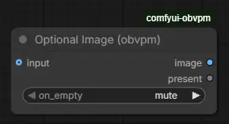

Pass the input through when connected. When the input is missing, the `on_empty` toggle decides what downstream sees:

- `mute` — block the path; every downstream node is skipped.
- `bypass` — output `None`; a downstream node with an optional input treats it as unconnected.

Each gate also has a **`present`** boolean output that is true when an input is connected. It stays live even in mute mode, so it can drive a Lazy Switch's boolean while the value path is dead. `Optional Any` is the wildcard version and accepts any type; its outputs are `value` and `present`.

#### Required Model

The minimal gate: passes a MODEL through. The input is required, so queueing with nothing connected is refused up front — a missing model is a loud error at this node rather than a mystery downstream.

#### Mute If

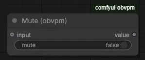

Passes any input through unchanged; when the `mute` boolean is true, blocks everything downstream. The boolean is connectable, so it can be driven by logic (e.g. a gate's `present` through a Boolean invert). Note: nodes *upstream* of the input still run — use a Lazy Switch when you want the upstream work skipped too.

#### Mute Group If

Mutes **the group it sits in** while `mute` is true (or while it is false, with `invert` on): every node in the frame is set to *Never*, so ComfyUI leaves it out of the run altogether -- loaders, samplers, save nodes, everything -- and draws it greyed. When the value turns, the group comes back.

- **Which group:** the smallest group frame holding the node's centre; its nodes are those whose centre is inside that frame (the frontend's own rule for what a group moves). Drag the node to another group and the muting follows it; outside every group it mutes nothing. The node itself is never muted.
- **Inside a subgraph** (say, the switch and its Get tidied into one), with no group around it in there, it acts on the group around the subgraph's node in the graph that holds it -- climbing on while that node is in no group either -- and does so for each place the subgraph is used. The subgraph's node is never muted (it holds the switch), nor what feeds it. A group drawn inside the subgraph still wins.
- **The value has to be known before the run**, because muting happens while the prompt is built: a widget, a primitive, a Value Presets field (through Unbundle or Get/Set), a Not of one, or a node that says so, like the timeline's upscale toggle. The nodes feeding it (a Get, a Not) are never muted, so they can sit beside it inside the group. When the value cannot be told, the group is left **on** -- the safe side wherever a switch or gate still decides at run time. The node shows no status line: the greyed group is the answer.
- **Only what it muted comes back:** a node you muted or bypassed yourself keeps its mode. Several Mute Group If nodes can cover the same nodes (nested groups); a node stays muted while any of them wants it.
- It applies whenever the value changes, and once more right before every queue. The node itself never runs (no outputs).

A node in a muted group that something *outside* the group still needs leaves that consumer without its input, so keep shared work outside such groups.

### Switches (obvpm/switches)

#### Lazy Switch

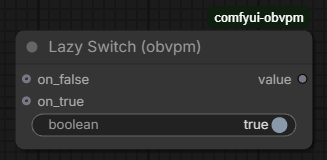

Outputs `on_true` when the boolean is true, else `on_false` — and only the selected branch executes. The entire upstream chain of the unselected side is skipped, making this the way to bypass whole groups of nodes conditionally.

Details that matter in practice:

- An unconnected selected side outputs `None` instead of erroring.
- A branch that was muted by a gate can be "picked back up": select the other side and the workflow continues.
- Drive the boolean from a gate's `present` output to switch automatically based on whether an input exists.

#### Lazy Switch 2 Values / 3 Values

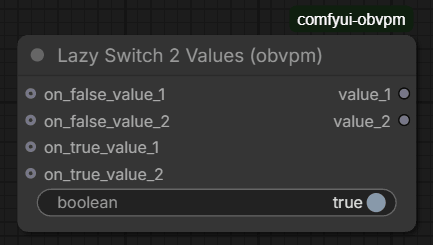

The same switch for several values at once: `boolean` selects between the `on_false_value_*` block and the `on_true_value_*` block, output as `value_1..N`. All slots switch together; unconnected slots on the selected side output `None`.

#### Lazy Case Switch

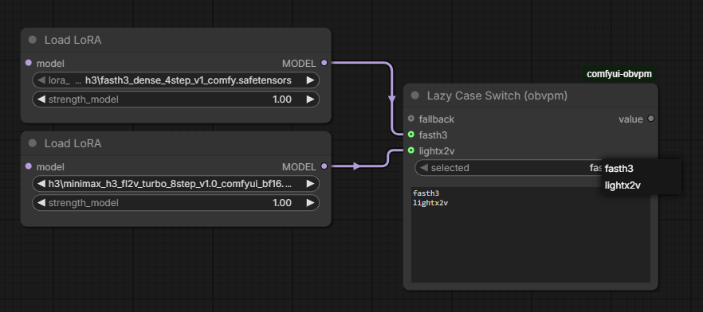

Picks a branch by **name** instead of by a boolean. Write the case names one per line in `cases`; the branch whose line matches `selected` executes and the others never run, exactly like the Lazy Switch.

Everything comes from that one list: **one `on_case` input appears per line, labelled with it**, and `selected` is a dropdown of the same lines. Add a line and a socket appears; remove one and it goes away — unless it is still connected, in which case it stays (labelled as having no line) rather than silently dropping the link.

- Names are matched exactly, with surrounding spaces ignored.
- Blank lines are ignored and do not consume a socket.
- Up to 16 cases.
- No match falls through to `fallback`, which sits above the case pins and stays put as the list is edited. With no fallback connected, the output is `None` (and the log says which name matched nothing).
- Wire a **Dropdown**'s `options` into `cases` and its `value` into `selected` to drive the switch from one shared list. A wired-in list behaves exactly like a typed one — the sockets appear and relabel as the Dropdown is edited. Unwire it and the node goes back to its own text.

#### Lazy Case Switch (auto)

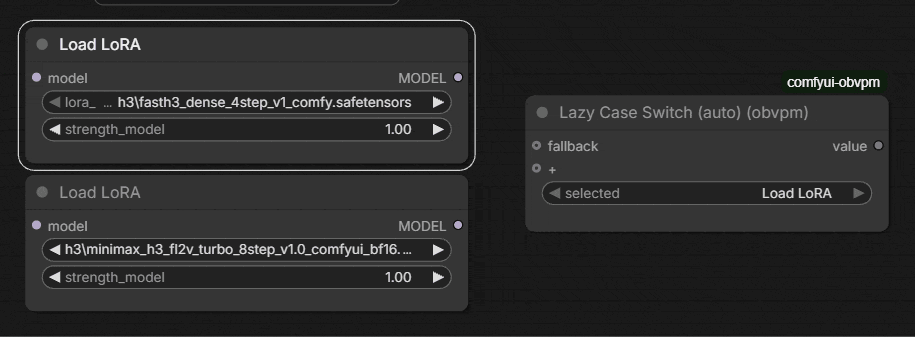

The same switch with no list to write: each branch is named after the node feeding it. Starts with a single empty input and grows another as each one fills, so there is always one spare; unplug one and the gap closes. `selected` is a dropdown of those names.

The name is the source node's **title**, keeping its own spacing and capitals — so rename a node and its branch is renamed with it, and titling the two ends of a fork "Upscale" and "Refine" is all the setup there is. Two branches from identically titled nodes are numbered (`Upscale`, `Upscale_2`).

Use the plain **Lazy Case Switch** when the names should be fixed — driven from a Dropdown, say, or matched against a string from elsewhere that has to keep meaning the same when the wiring changes.

## Misc

### Values and pickers (obvpm/values)

#### Dropdown

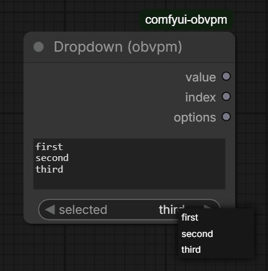

A dropdown you define yourself: type the choices one per line in `options` and pick one from `selected`. Outputs the chosen line (`value`), its position counting from 0 (`index`), and the list itself (`options`).

The `options` passthrough is what pairs it with a Lazy Case Switch: feed it into the switch's `cases` and `value` into its `selected`, and the choices, the branch sockets and their labels all derive from one list.

Editing the options refills the dropdown immediately; an empty selection means the first option. If the selected line is later removed from `options`, the node refuses rather than quietly choosing something else — a saved workflow shouldn't change meaning behind your back.

The options live on the node instance, not in `INPUT_TYPES`: the frontend hands the combo widget a function for its list. The input stays a plain string server-side, so the node still works as a text field if the JS doesn't load.

Note ComfyUI ships an experimental **Custom Combo** node that also offers user-defined options. This one differs in keeping its list as a plain multiline string — visible, diffable, and wire-able into a Lazy Case Switch.

#### First Float / First Int (else fallback)

Output the first connected input that carries a value; if none do, output the `fallback` widget value. Three candidate inputs each (`float1..3` / `int1..3`). Inputs fed by a gate in bypass mode (`None`) are skipped over, so several optional paths fan back into one guaranteed value.

#### Lora Name

Pick a LoRA file and send its name down a wire. The list is the same one a loader shows, read live from the `models/loras` folder. Nothing is loaded here — the value is the **name only** (with any subfolder), so it can be bundled, switched between presets, or fed to several loaders at once. The output is untyped so it plugs straight into a loader's own `lora_name` combo.

#### Sampler Name

Pick a sampler and send it down a wire, instead of setting it on the sampler node itself. Two outputs: `sampler`, typed to match any `sampler_name` combo (KSampler, KSamplerSelect, …), and `sampler_name`, the same choice as a plain string for bundling or captions.

#### Scheduler Name

The same for schedulers: `scheduler` plugs into any scheduler combo, `scheduler_name` is the plain string. The list is read live, so schedulers registered by a pack — this one's `beta57` included — appear here too.

The three pickers keep the socket names of the nodes they replace (see [THIRD_PARTY_NOTICES](THIRD_PARTY_NOTICES.md)), so an existing graph only has to change the node type.

### Clean VRAM (obvpm/misc)

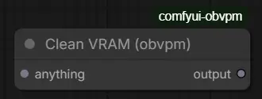

Unloads every loaded model and releases cached VRAM, then passes its input straight through. Put it on the wire between two stages that will not fit in memory together — a decode after a long sample, say. The `anything` input is passed through untouched as `output`; its only job is to place the cleanup in execution order, so wire the output onward to whatever needs the room.

Everything unloaded is reloaded on next use, so the cost is that reload time; place it where that is cheaper than running out of memory. It is an output node, so it runs even when nothing consumes its output.

### beta57 scheduler

This pack automatically adds **beta57** for you if you don't have or don't want to install [RES4LYF](https://github.com/ClownsharkBatwing/RES4LYF).

beta57 is the beta sigma schedule with `alpha=0.5, beta=0.7`, popularized by RES4LYF. It appears in every scheduler dropdown (KSampler, BasicScheduler, [Scheduler Name](#scheduler-name), …) and behaves like a built-in.

## License

[GPL-3.0](LICENSE). See [THIRD_PARTY_NOTICES](THIRD_PARTY_NOTICES.md) for acknowledgments.
